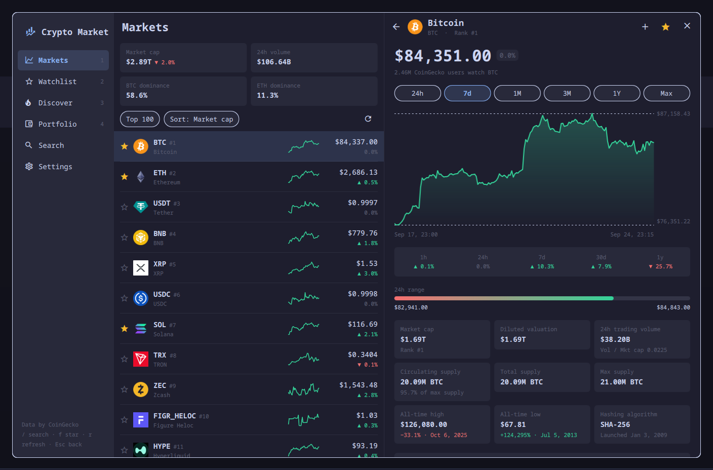
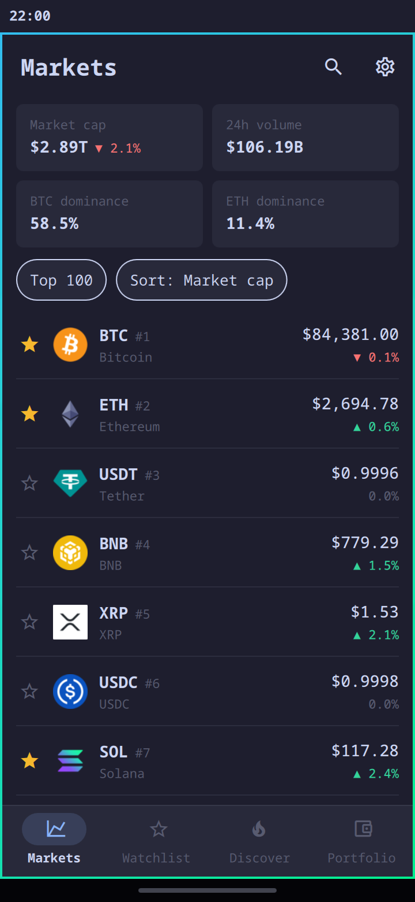

# Crypto Market

CoinGecko as an Omarchy app: live prices, coin pages, a watchlist and a
portfolio, in an app window that lays itself out for the desktop and for the phone.





## Contents

- [Features](#features)
- [Requirements](#requirements)
- [Installation](#installation)
- [Usage](#usage)
- [Configuration](#configuration)
- [Update and removal](#update-and-removal)
- [Privacy and security](#privacy-and-security)
- [Credits and license](#credits-and-license)

## Features

**Markets**
- The top 100, 250, 500 or 1,000 coins by market cap, with price, 1h/24h/7d
  change, volume, market cap and a 7-day sparkline. Sort by any column.
- Above the list: total market cap, 24h volume, and BTC and ETH dominance.

**Coin pages**
- A price chart for 24h, 7d, 1M, 3M, 1Y or Max, with a crosshair.
- The change over 1h, 24h, 7d, 30d and 1y, and the 24h range.
- Market cap, fully diluted valuation, volume, and circulating, total and max supply.
- All-time high and low, with dates.
- The project's description, categories and links.
- A converter: coin to currency and back.
- **Compare**: the chart icon in the top bar puts up to four coins on one chart, each rebased to 0% at the
  start of the range, so Bitcoin and a one-cent coin share a scale. Pick from
  Bitcoin, Ethereum, Solana, your watchlist and the top of the market.

**Discover, search and watchlist**
- Trending coins on CoinGecko.
- The day's biggest gainers and losers among the top 250 (anything under $50K
  of volume is left out), and every category by market cap.
- A **heatmap** of the top 60 coins: area follows market cap (compressed, so
  small coins stay visible), colour follows the 24h change. Press a tile to
  open the coin.
- Search for any coin CoinGecko lists.
- Star any coin to add it to your watchlist.

**Portfolio**
- Record buys and sells to see today's value, the 24h change, profit and loss
  per coin, and an allocation bar.
- A value-over-time chart (7d, 1M, 3M, 1Y) built from your transactions and
  each coin's price history, for your twelve largest holdings. It shows the
  value of what you held, so it steps when you add a buy or a sell.

**Everything else**
- 15 currencies, including BTC, ETH and sats.
- Opens instantly and offline with the last prices it saw, and refreshes only
  while it is open.

## Requirements

- [Omarchy](https://omarchy.org) with its shell, which provides Quickshell.
- The JetBrains Mono Nerd Font the icons are drawn in.
- Network access to `api.coingecko.com`.

## Installation

Crypto Market is an Omarchy plugin. It stays loaded in the shell, so it opens
instantly:

```sh
omarchy plugin add https://github.com/JeremyT2002/crypto-market-omarchy.git --enable
```

The first time it loads, Crypto Market adds itself to Omarchy's app menu so you
can search for it by name. It does this once, and only if no entry by that name
exists yet. **Settings → App launcher** hides or shows the entry. On Omarchy
Mobile it appears in the app drawer as its own app.

## Usage

### Opening the app

Bind a key in `~/.config/hypr/bindings.lua`:

```lua
o.bind("SUPER + SHIFT + C", "Crypto Market", "omarchy-shell shell toggle io.github.simonschubert.crypto-market")
```

Or run `omarchy-shell shell toggle io.github.simonschubert.crypto-market` from
anywhere.

Crypto Market opens as a normal window, so Hyprland tiles, focuses and closes
it like any other app. The keybinding toggles it.

### Keys (desktop)

| Key | Action |
| --- | --- |
| `1`–`4` | Markets, Watchlist, Discover, Portfolio |
| `/` | Search |
| `↑` `↓` `Enter` | Move through a list, open a coin |
| `←` `→` | Chart range on a coin page |
| `f` | Star or unstar the selected coin |
| `r` | Refresh |
| `Esc` | Back one step (close the window with your usual close key) |

## Configuration

### Rate limits and the API key

CoinGecko's free public API answers only a few requests a minute. The app
spaces its requests out and caches every answer. When CoinGecko asks it to
slow down, it keeps showing the prices it has and retries by itself.

For more headroom, create a free **Demo** key at
[coingecko.com/en/developers/dashboard](https://www.coingecko.com/en/developers/dashboard)
and paste it into Settings. The key is stored in
`~/.local/state/crypto-market/prefs.json` and is sent only to CoinGecko.

### Where it keeps its files

| Path | Contents |
| --- | --- |
| `~/.local/state/crypto-market/prefs.json` | Settings, watchlist, portfolio and the optional API key |
| `~/.cache/crypto-market/` | The last prices (for opening offline) and the coin logos |
| `~/.local/share/applications/omarchy-plugin-io.github.simonschubert.crypto-market.desktop` | Its app menu entry, created once and never over an existing file |

## Update and removal

### Update

```sh
omarchy plugin update io.github.simonschubert.crypto-market
omarchy-restart-shell
```

The restart matters: Crypto Market stays loaded between opens, and Omarchy
keeps a loaded plugin's old code running until the shell restarts.

### Remove

```sh
omarchy plugin remove io.github.simonschubert.crypto-market
```

That removes the plugin itself. Your settings, watchlist and portfolio, the
saved prices and logos, and the app menu entry stay behind. To remove those as
well:

```sh
rm -rf ~/.local/state/crypto-market ~/.cache/crypto-market
rm -f ~/.local/share/applications/omarchy-plugin-io.github.simonschubert.crypto-market.desktop
```

If you added a keybinding, remove it from `~/.config/hypr/bindings.lua`.

## Privacy and security

- **Network:** the only access is HTTPS requests from QML to
  `api.coingecko.com`, plus coin logos from CoinGecko's own image hosts
  (`coin-images.coingecko.com`, `assets.coingecko.com`). A logo address
  anywhere else is ignored.
- **Download caps:** every answer is capped while it downloads, at 8 MB for API
  answers and 300 KB for a logo. An answer that declares more, or grows past
  that, is dropped before it is held in full.
- **Processes:** it runs no shell commands. At startup it runs
  `install -d -m 700` on its own state and cache folders, and `chmod 600` on its
  two data files, so your API key and portfolio are readable only by you. It
  runs no other processes. If either step fails, it saves nothing and says so
  on screen.
- **Files:** it installs no packages, changes no Omarchy configuration, and
  writes only the files listed under [Configuration](#where-it-keeps-its-files).
- **Content:** project descriptions are shown as plain text. Links open in your
  browser, and only `https:` links are opened.

## Credits and license

Market data by [CoinGecko](https://www.coingecko.com). This is not financial advice.

Crypto Market is an independent project. It is not affiliated with or endorsed
by Omarchy, 37signals, Quickshell or CoinGecko.

Originally created by Simon Schubert. Released under the [MIT License](LICENSE).
